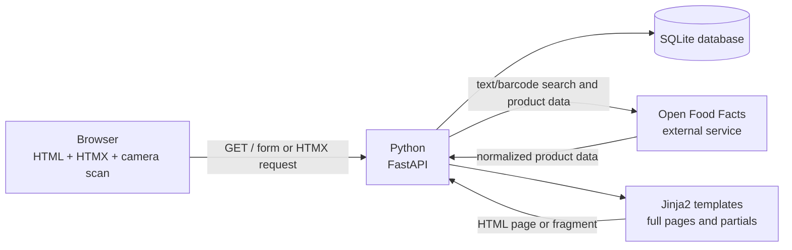

# CalorHost architecture

## Tech stack

| Concern                 | Choice                                                  |
| ----------------------- | ------------------------------------------------------- |
| Language and runtime    | Python; FastAPI                                         |
| UI                      | Server-rendered HTML with Jinja2, HTMX                  |
| Database                | SQLite (but keep code extensible)                       |
| Database access         | SQLAlchemy, with Alembic migrations                     |
| External food data      | Open Food Facts behind an application service/client    |
| Packaging/configuration | `pyproject.toml`/`uv`; environment-driven configuration |

## Runtime architecture

## Post-MVP

1. Choose a deployment target (e.g., Docker or a VPS).
2. Add responsive styling and a UI framework such as Tailwind.
   - Consider Alpine.js if client-side interactivity is needed.
3. Add authentication and support for multiple users.
4. Evaluate PostgreSQL.
