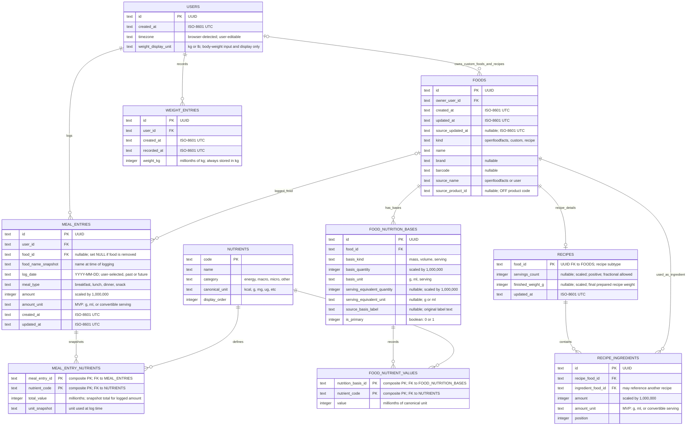

# Calorie Tracker Database ERD

This is an SQLite-oriented initial design for the single-user MVP

## Design notes

- Store application-generated UUIDs as canonical text, dates and timestamps as
  ISO-8601 text, booleans as `0`/`1` integers, and decimal quantities as integer
  millionths. For example, store `150.25 g` as `150250000`. Convert scaled
  values to and from `Decimal` in the application; avoid SQLite `REAL` for
  nutrition and measurements.
- Enable SQLite foreign keys (`PRAGMA foreign_keys = ON`) on every connection.
  Add `CHECK` constraints for booleans, positive quantities, allowed enum-like
  values, and recipe requirements because SQLite does not strictly enforce
  declared types.
- Store timestamps in UTC using one ISO-8601 format. Store
  `MEAL_ENTRIES.log_date` as the user's selected calendar date (`YYYY-MM-DD`),
  not a timestamp.
- Use the same nutrient model for all nutrients. A missing
  `FOOD_NUTRIENT_VALUES` row means the value is unknown; a row with value `0`
  means zero is known. Require energy, protein, fat, and carbohydrates together
  on at least one basis for every usable food. Zero is valid for all four.
- Accept energy in kcal or kJ and normalize it to the canonical unit, kcal.
  Missing values for all other nutrients contribute zero to calculations, while
  remaining distinct from known zero in storage.
- Enforce required nutrient completeness in application validation because it
  spans nutrition bases and nutrient-value rows.
- Store a per-100-g basis as `basis_quantity = 100`, `basis_unit = g`, and a
  per-serving basis as `basis_quantity = 1`, `basis_unit = serving`. When known,
  `serving_equivalent_quantity` and `serving_equivalent_unit` record the serving's
  weight or volume for conversion to g or ml.
- Use the basis matching the logged amount unit when available. If a nutrient is
  absent from that basis, use another basis only when a known conversion applies.
  The required four nutrients must be calculable for the selected amount unit.
- `FOOD_NUTRITION_BASES` and `FOOD_NUTRIENT_VALUES` hold imported or user-entered
  nutrition. Calculate recipe nutrition from ingredients rather than storing
  aggregate values in these tables.
- For text or barcode OFF searches, save or update the local food only when the
  user commits a meal entry. Update from the latest OFF response and snapshot
  that same data in one transaction. Canceling the flow leaves local data
  unchanged.
- Snapshot meal-entry nutrient totals when food is logged so later changes to a
  food or recipe do not alter historical entries. Editing an amount uses its
  existing snapshot; selecting a different food uses current data.
- Aggregate dashboard meal and daily totals from `MEAL_ENTRY_NUTRIENTS` by user,
  date, meal, and nutrient; no separate totals are needed.
- Index `FOODS.name` and `FOODS.brand`, and add a SQLite partial unique index on
  `(source_name, source_product_id)` where `source_product_id IS NOT NULL`.
- Require at least one of `servings_count` and `finished_weight_g` in each
  recipe, and require each provided value to be positive. Either value supports
  its corresponding nutrition basis; both support per-serving and per-100-g
  calculations. Finished weight is the prepared recipe's weight, not the sum of
  raw ingredient weights. Calculate recipe nutrition dynamically from current
  ingredient data, require at least one ingredient, and snapshot totals in
  `MEAL_ENTRY_NUTRIENTS` when logged. Allow fractional serving counts. Prevent
  direct and indirect recipe cycles.
- Do not archive foods. Block deleting a food or recipe while a recipe uses it.
  When deleting an unreferenced food, set historical `MEAL_ENTRIES.food_id` to
  NULL and retain its name and nutrient snapshots. Deleting a meal entry does not
  delete its food.
- For the MVP, meal and recipe-ingredient amounts use g, ml, or a serving only
  when the food has a defined conversion. Household portions need food-specific
  conversions; grams and millilitres are not interchangeable.

## Entity relationship diagram

